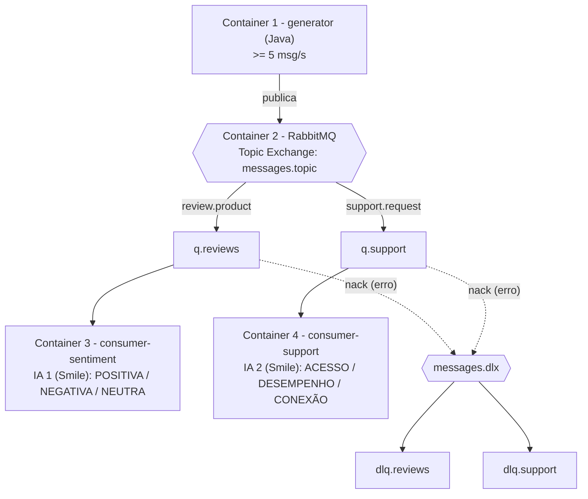

# Atividade 5 – Sistema Distribuído de Classificação Inteligente de Mensagens com RabbitMQ

Sistema distribuído em **Java 17 + Docker Compose + RabbitMQ + IA embarcada (Smile)** que gera, distribui e classifica mensagens automaticamente por meio de dois consumidores independentes.

## Arquitetura (4 containers, mesma rede `rede-mensagens`)



| Serviço | Função |
|---|---|
| `generator` | Gera 6 msg/s (configurável, mínimo 5) de avaliações de produtos e solicitações de suporte. Cada mensagem é JSON com `id` (UUID), `timestamp` (ISO-8601), `type` e `content`. Publica com routing key `review.product` ou `support.request`. A cada N mensagens (`POISON_EVERY`) envia uma mensagem "envenenada" para demonstrar a DLQ. |
| `rabbitmq` | `rabbitmq:3.13-management`. Topic Exchange `messages.topic`, filas `q.reviews` e `q.support` (uma por consumidor), Dead Letter Exchange `messages.dlx` com `dlq.reviews` e `dlq.support`. Interface de administração em http://localhost:15672 (admin / admin123). |
| `consumer-sentiment` | Consome `q.reviews`, classifica o sentimento e imprime no console. |
| `consumer-support` | Consome `q.support`, classifica a categoria do problema e imprime no console. |

### Regras técnicas atendidas
- Todos os serviços em containers Docker, na mesma rede, configurados via `docker-compose.yml`.
- Topic Exchange com as routing keys `review.product` e `support.request`; uma fila por consumidor.
- **ACK manual** (`autoAck=false`, `basicAck` só após processar) e `basicQos(1)`.
- **DLQ**: erro de processamento => `basicNack(requeue=false)` => a fila tem `x-dead-letter-exchange` => mensagem vai para `dlq.reviews` / `dlq.support` (não é descartada).
- Consumidores **mais lentos que a geração** (`PROCESSING_DELAY_MS=1500` => ~0,67 msg/s por consumidor contra ~3 msg/s chegando em cada fila), então as filas crescem visivelmente.
- Cada consumidor tem **sua própria IA** (modelo treinado separadamente, com dataset próprio).

## As IAs embarcadas

Ambas usam a biblioteca **Smile** (`smile-core 3.1.1`), sem chamadas a APIs externas:

1. Pré-processamento: minúsculas, remoção de acentos e pontuação, tokenização, bigramas de negação (`nao_gostei`).
2. Representação: Bag-of-Words (frequência de termos) com normalização L2.
3. Modelo: **Regressão Logística multinomial** (`smile.classification.LogisticRegression`), treinada na inicialização do container com um dataset de exemplos em português (`TrainingData.java`) com ~11-14 frases por classe.
4. Saída: classe prevista + probabilidade (confiança).

- **IA 1 (sentimento):** POSITIVA, NEGATIVA, NEUTRA.
- **IA 2 (suporte):** PROBLEMA DE ACESSO, PROBLEMA DE DESEMPENHO, PROBLEMA DE CONEXÃO.

> Limitação: o dataset é pequeno e didático; frases com vocabulário totalmente novo podem ser classificadas com menor confiança.

## Como executar

Pré-requisitos: Docker Desktop (com WSL2 no Windows) e Git.

```bash
git clone <URL-DO-SEU-REPOSITORIO>
cd <pasta-do-repositorio>
docker compose up --build
```

O primeiro build baixa as dependências Maven (alguns minutos). Depois:

- Logs de todos os serviços: `docker compose logs -f`
- Logs de um serviço: `docker compose logs -f consumer-sentiment`
- Interface do RabbitMQ: http://localhost:15672 (admin / admin123) -> aba **Queues**
- Parar tudo: `docker compose down` (use `docker compose down -v` para apagar também as filas)

### Forçar uma mensagem com erro (DLQ)
Windows (PowerShell): `./scripts/enviar-erro.ps1` (ou `./scripts/enviar-erro.ps1 support.request`)
Linux/Mac: `./scripts/enviar-erro.sh` (ou `./scripts/enviar-erro.sh support.request`)

Além disso, o gerador envia automaticamente 1 mensagem com erro a cada 100 mensagens.

### Variáveis de ambiente úteis (docker-compose.yml)
| Variável | Serviço | Padrão | Efeito |
|---|---|---|---|
| `MESSAGES_PER_SECOND` | generator | 6 | taxa de geração |
| `POISON_EVERY` | generator | 100 | 1 mensagem com erro a cada N (0 desliga) |
| `PROCESSING_DELAY_MS` | consumidores | 1500 | atraso artificial por mensagem |

## Estrutura
```
docker-compose.yml
generator/            (Dockerfile, pom.xml, src)
consumer-sentiment/   (Dockerfile, pom.xml, src)
consumer-support/     (Dockerfile, pom.xml, src)
scripts/              (enviar-erro.ps1 / enviar-erro.sh)
evidencias/           (capturas de tela da interface do RabbitMQ)
```

## Evidências
Capturas em `evidencias/`: filas crescendo, exchange/bindings, DLQ com mensagem, logs dos consumidores.

## Vídeo de demonstração
<COLE AQUI O LINK DO VÍDEO>
